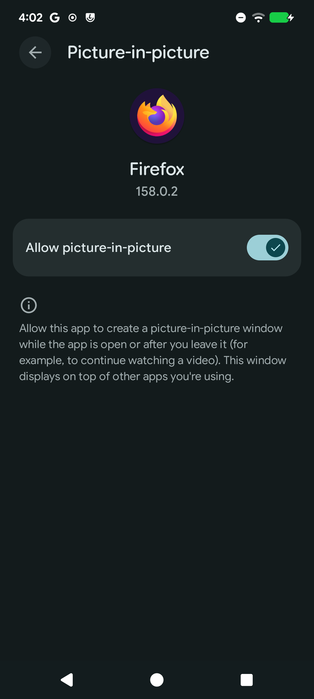
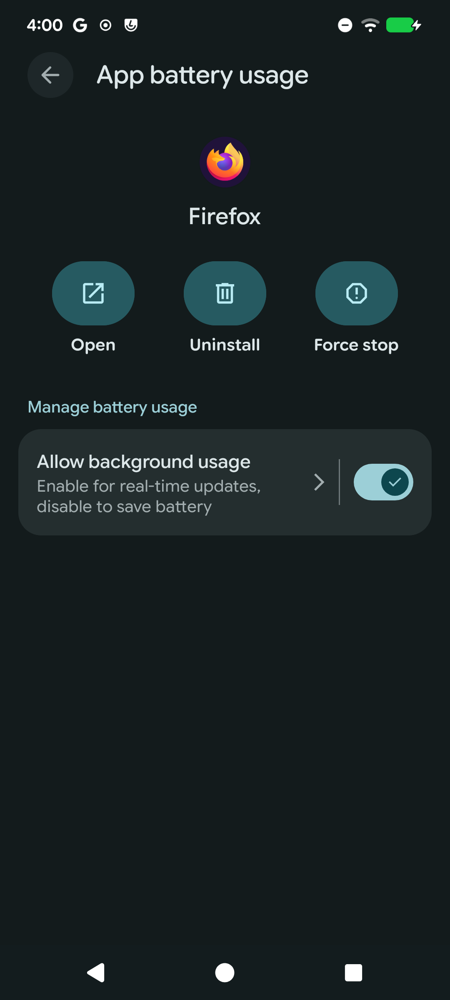
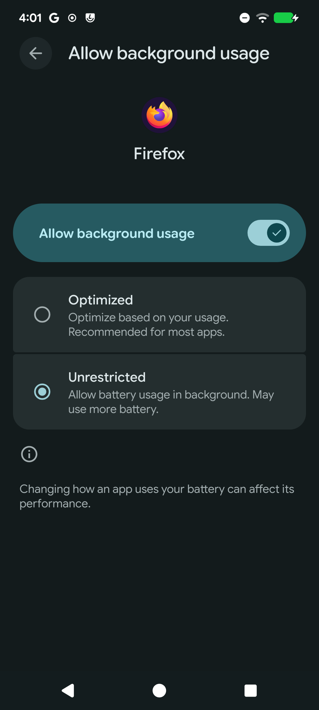

# Set up Android for HTML PiP Helper

This guide covers floating video windows and audio playback while the screen is
locked. The screenshots show a real Android 16 device with Firefox 158.0.2 and
English system labels. Menu names and locations can differ on other Android
versions and manufacturer interfaces.

| Setting | Configuration |
| --- | --- |
| HTML PiP Helper | Installed and enabled in Firefox |
| Picture-in-picture for Firefox | Allowed |
| Background usage for Firefox | Allowed |
| Battery usage for locked-screen playlists | Unrestricted on the tested device |
| Remote debugging | Needed only for development, not everyday playback |

## 1. Install and enable the extension

Open [HTML PiP Helper on Firefox Add-ons](https://addons.mozilla.org/de/firefox/addon/html-pip-helper/)
in Firefox for Android, install it, and confirm the permissions. Check that the
extension is enabled, then reload any video tabs that were already open.

Alternatively, download the Mozilla-signed
[`html_pip_helper-0.1.3.xpi` from the GitHub release](https://github.com/ckbaker10/html-pip-helper/releases/download/v0.1.3/html_pip_helper-0.1.3.xpi).
The release also provides `SHA256SUMS`. The package produced by this repository's
build command is unsigned; use the published signed file for permanent installation.

To install a signed XPI from a file:

1. Save the signed file on your phone.
2. In Firefox, open **Settings → About Firefox**.
3. Tap the Firefox logo five times quickly to reveal the additional menu item.
4. Return to **Settings → Install Extension from File**, select the XPI, and
   confirm the installation.
5. Open Firefox's extensions list and check that **HTML PiP Helper** is enabled.
6. Reload video tabs that were already open before installation.

Temporary developer installations disappear when Firefox restarts. Reinstall a
temporary build before testing again, or use a signed package for everyday use.
If you use private tabs, separately allow the extension to run in private browsing
where Firefox offers that permission.

See [Mozilla's installation instructions](https://extensionworkshop.com/documentation/publish/install-self-distributed/).

## 2. Allow picture-in-picture

1. Open Android **Settings → Apps → Firefox**. Long-pressing the Firefox launcher
   icon and choosing **App info** is another way to reach this page.
2. Open **Picture-in-picture**, sometimes listed under **Advanced**.
3. Enable **Allow picture-in-picture**.

On devices that group these permissions elsewhere, look under
**Settings → Apps → Special app access → Picture-in-picture → Firefox**.

Start a video, use its existing fullscreen button, then press Android Home or
swipe to the home screen. Firefox should open the native floating window. A
separate **Display over other apps** permission is not needed for this PiP flow.

## 3. Allow unrestricted background usage

For audio and playlist transitions while the screen is locked, Firefox must be
able to fetch media in the background. On the tested device, an enabled
**Allow background usage** switch alone was not enough: the separate battery
mode also had to be **Unrestricted**.

1. Open Android **Settings → Apps → Firefox → App battery usage**.
2. Enable **Allow background usage** if it is off.
3. Tap the **Allow background usage** row or its arrow to open the detailed options.
4. Select **Unrestricted** instead of **Optimized**.

The detailed page contains the additional selection:

These images illustrate the settings to choose. The phone used for capture was
returned to its original **Optimized** mode afterward. Choosing **Unrestricted**
can increase battery use. Other devices may call the equivalent option
**Don't optimize** or place it under **Battery optimization**.

On the tested device, Android blocked Firefox's Internet access between videos
with the reason `APP_BACKGROUND`. A temporary battery exemption removed the
block and allowed the next playlist item to start while the screen stayed
locked. Removing the exemption restored the block. The extension cannot change
this system policy; granting PiP permission also does not remove it.

If your device separately restricts background data or uses Data Saver, check
Firefox's data-usage permissions too. Data Saver was already off in the confirmed
test, so disabling Data Saver alone would not have addressed that case.

## 4. Check playback and automatic transitions

1. Reload the video page after installing or re-enabling the extension.
2. Start a video with audible sound while Firefox is in the foreground.
3. Enter fullscreen and press Home to check PiP with the screen on.
4. For a playlist, enable the player's own autoplay or continuous-play setting.
5. Lock the screen and listen for continued audio. Wait for the current item to
   finish and check whether the next one starts without unlocking or pressing Play.
6. Unlock the phone and confirm that playback and the controls still work.

With the screen locked or off, the floating picture is not visible; this check is
about continued audio and automatic transitions. A loading pause can occur. One
automatic transition was confirmed on the real device with a battery exemption;
this does not guarantee gapless playback or compatibility with every player.
See the [test report](../TESTING.md#locked-screen-playback-and-background-network-access).

## Troubleshooting

| Symptom | Check |
| --- | --- |
| No floating window after pressing Home | Start playback first, enter fullscreen with the player's button, and check Firefox's PiP permission. |
| The current item plays, but the next one waits until you unlock | Check **Allow background usage**, the **Unrestricted** battery mode, background data permissions, and the player's autoplay setting. |
| Playback stops immediately when locking | Check background restrictions and that the extension is still installed and enabled. A manual media Play command can resume some players, but does not prove automatic transitions will work. |
| The extension disappears after restarting Firefox | Temporary development installations do not persist. Install from [Firefox Add-ons](https://addons.mozilla.org/de/firefox/addon/html-pip-helper/) or use the signed release XPI. |
| A private tab behaves differently | Check Firefox's permission for the extension to run in private browsing. |
| The picture turns black after rapid Home or app switches | This can be a decoding error, separate from a background network block. Recovery is limited to supported players and sources; see the [README](../README.md#permissions-and-limitations). |

## Development-only debugging

Normal installation and playback do not require ADB, Android wireless debugging,
or Firefox's USB remote-debugging option. Enable them only for a development
session and disable them afterward if you no longer need remote access. No
unlock code or lock-screen change is needed for the extension.

Do not run `npm run test:android` on your everyday phone: that emulator test resets
Firefox's app data. See the [emulator test instructions](../README.md#android-emulator-test).

## Screenshot provenance and references

The images are unedited settings screenshots captured on the test device on
2026-10-22. They show only the relevant Firefox app settings. Private diagnostic
screenshots and logs remain outside the published repository.

- [Mozilla: playing videos in Firefox for Android](https://support.mozilla.org/en-US/kb/playing-videos-firefox-android)
- [Mozilla: installing self-distributed extensions](https://extensionworkshop.com/documentation/publish/install-self-distributed/)
- [Mozilla: signing and distributing extensions](https://extensionworkshop.com/documentation/publish/signing-and-distribution-overview/)
